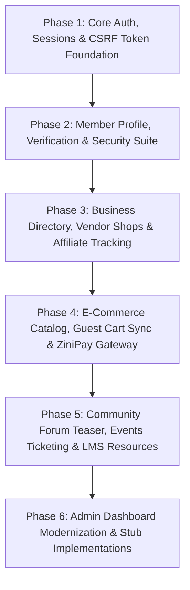

# BDSisters.org — Comprehensive Frontend QA Audit & Backend Integration Checklist
**Document Version:** 1.0.0  
**Generated On:** November 19, 2026  
**Auditor:** Senior Full-Stack QA Auditor & Frontend Architect  
**Target Repository:** `bdsisters` (Next.js 16+ App Router, React 19, TypeScript, Tailwind CSS, TanStack Query)

---

## 1. Executive Summary & Integration Readiness Score

### 1.1 Overview
An exhaustive code-level audit was conducted across all frontend tiers of the **BDSisters.org** application:
1. **Public Portal** (`src/app/(public)` & `src/features/public`)
2. **Member Dashboard** (`src/app/member` & `src/features/member`)
3. **Admin Dashboard** (`src/app/admin` & `src/features/admin`)
4. **Shared Services & Data Layer** (`src/lib/services`, `src/features/*/services`, `src/lib/db`)

The audit evaluated demo/mock data sources, direct database coupling (`mongodb.ts`), "Coming soon." stub placeholders, and adherence to the **BDSisters.org Master Requirements**.

### 1.2 Quantitative Audit Metrics
| Metric | Count / Status | Notes |
| :--- | :--- | :--- |
| **Total Mock Data Files** | **11 files** | Dedicated mock files in `src/features/*/data/mock-*.ts` |
| **Direct MongoDB Service Couplings** | **8 files** | Files calling `getDatabase()` / `mongodb.ts` directly on frontend/SSR |
| **Placeholder / "Coming Soon" Routes** | **16 routes** | 7 in `/admin/*`, 9 in `/member/*` |
| **Rest API Target Endpoints Identified** | **68 endpoints** | Spanning Auth, Users, Business, Ecommerce, Forum, Events, LMS, CMS, Admin |
| **Frontend UI Completeness** | **91%** | Rich interactive components, forms, filters, and modals already built |
| **Backend Integration Readiness Score** | **78 / 100** | Ready for systematic REST API wiring; mock detachment required |

---

## 2. Public Portal (`(public)`) — Demo Data & API Mapping Table

The public portal provides guest access, discovery, public business directories, e-commerce catalog, and guest teasers.

| # | Route / File Path | Current Mock / Static Source | Target Backend Endpoint | Required UI / Logic Update |
| :--- | :--- | :--- | :--- | :--- |
| **PUB-01** | `/` (Home)<br>`src/app/(public)/page.tsx`<br>`src/features/public/components/home-view.tsx` | `publicService.getFeaturedBusinesses()` and `publicService.getFeaturedProducts()` fallback to MongoDB or static arrays. | `GET /api/public/featured-businesses`<br>`GET /api/ecommerce/products?featured=true`<br>`GET /api/events?featured=true` | Replace direct service MongoDB calls with `apiClient` queries; add skeleton loaders during SSR/client fetch. |
| **PUB-02** | `/about`<br>`src/app/(public)/about/page.tsx` | Static content & hardcoded statistics (`membersCount: '15,000+'`, `businessesCount: '450+'`). | `GET /api/public/platform-stats`<br>`GET /api/cms/pages/about` | Fetch live community platform counters and dynamic CMS hero blocks. |
| **PUB-03** | `/businesses`<br>`src/app/(public)/businesses/page.tsx` | `businessService.getApprovedBusinesses()` calls direct MongoDB in SSR. | `GET /api/business?status=approved&page=1&limit=12&category=&search=` | Convert to TanStack Query with URL query params synchronization (`searchParams`); display verified badge. |
| **PUB-04** | `/businesses/[slug]`<br>`src/app/(public)/businesses/[slug]/page.tsx` | `businessService.getBusinessBySlug(slug)` uses direct Mongo collection query; external link has direct `<a>` tag. | `GET /api/business/:slug`<br>`POST /api/business/:id/affiliate-click` | Wire external website/store links to intercept click and trigger background analytics tracking. |
| **PUB-05** | `/marketplace`<br>`src/app/(public)/marketplace/page.tsx` | `productService.getApprovedProducts()` directly connects to MongoDB. | `GET /api/ecommerce/products?status=active&category=&minPrice=&maxPrice=&wholesaleOnly=` | Wire server/client product catalog; display strike-through MRP, Special Discount Price, and Wholesale minimum quantity tags. |
| **PUB-06** | `/marketplace/[slug]`<br>`src/app/(public)/marketplace/[slug]/page.tsx` | `productService.getProductBySlug()` uses direct DB; product reviews use inline demo review list. | `GET /api/ecommerce/products/:slug`<br>`GET /api/ecommerce/products/:id/reviews` | Display verified buyer reviews with dual breakdown (Product Quality score vs. Brand Service score). |
| **PUB-07** | `/cart`<br>`src/app/(public)/cart/page.tsx`<br>`src/features/ecommerce/components/cart-view.tsx` | `useCartStore` reads `localStorage` only; does not synchronize with authenticated backend cart. | `GET /api/ecommerce/cart`<br>`POST /api/ecommerce/cart` (Sync/Merge) | On user login, trigger guest-to-account cart merge API; calculate live delivery charges per district. |
| **PUB-08** | `/checkout`<br>`src/app/(public)/checkout/page.tsx`<br>`src/features/ecommerce/components/checkout-view.tsx` | Mock order creation flow; no live gateway redirection. | `POST /api/payment/zinipay/init`<br>`POST /api/ecommerce/orders` | Initiate SSLCommerz / ZiniPay checkout session; redirect customer to secure `GatewayPageURL`. |
| **PUB-09** | `/community`<br>`src/app/(public)/community/page.tsx` | Static forum preview threads. | `GET /api/forum/posts?teaser=true` | Enforce **Guest Teaser Blur Gate**: render title + first 2 sentences, followed by smooth gradient overlay and CTA: *"Be a member to read the full post. It's Free"*. |
| **PUB-10** | `/events` & `/events/[slug]`<br>`src/app/(public)/events/page.tsx`<br>`src/app/(public)/events/[slug]/page.tsx` | Static event cards from `mock-events.ts`. | `GET /api/events?status=upcoming`<br>`GET /api/events/:slug`<br>`POST /api/events/:id/rsvp` | Free events call RSVP endpoint; paid events call `POST /api/events/:id/ticket` and redirect to ZiniPay gateway. |
| **PUB-11** | `/learning` & `/learning/[slug]`<br>`src/app/(public)/learning/page.tsx` | Hardcoded course cards. | `GET /api/lms/courses`<br>`GET /api/lms/courses/:slug` | Display course syllabus, instructor bio, enrollment prerequisites, and pricing. |
| **PUB-12** | `/resources` & `/resources/[slug]`<br>`src/app/(public)/resources/page.tsx` | Static PDF resource list. | `GET /api/resources?category=`<br>`POST /api/resources/:id/download` | Enforce login-wall on restricted downloadable PDF/eBook materials. |
| **PUB-13** | `/members` & `/members/[slug]`<br>`src/app/(public)/members/page.tsx` | `userService.getPublicMembers()` calls MongoDB directly. | `GET /api/users/public?page=&skills=&division=` | Enforce **PLUS-only contact protection**: hide phone, email, and social handles unless user has PLUS membership or permission. |
| **PUB-14** | `/[...slug]` (Dynamic CMS)<br>`src/app/(public)/[...slug]/page.tsx` | Direct calls to `cmsService.getPageBySlug()`. | `GET /api/cms/pages/:slug`<br>`GET /api/cms/tooltips` | Retain reserved routes safety guard (`api`, `_next`, `member`, `admin`); render dynamic CMS layout blocks. |

---

## 3. Member Dashboard (`/member`) — Demo Data, Stubs & API Mapping Table

The member dashboard handles profile management, business listings, vendor shops, order history, life balance goals, and communication.

| # | Route / File Path | Current Status / Mock Source | Target Backend Endpoint | Required UI / Logic Update |
| :--- | :--- | :--- | :--- | :--- |
| **MEM-01** | `/member` (Dashboard Home)<br>`src/app/member/page.tsx` | Mixed live auth state with hardcoded metric cards (`activeOrders: 2`, `savedItems: 14`). | `GET /api/member/dashboard-stats`<br>`GET /api/member/recent-activities` | Connect KPI cards (Orders, Verification status, Goal progress, Unread notifications) to live aggregator API. |
| **MEM-02** | `/member/profile`<br>`src/app/member/profile/page.tsx` | Uses `useSession()` user object; lacks full profile details (division, district, bio, skills, affiliations). | `GET /api/users/profile/me`<br>`GET /api/auth/export-pdf` | Load comprehensive profile data; connect "Download Profile PDF" button to backend PDF generator. |
| **MEM-03** | `/member/profile/edit`<br>`src/app/member/profile/edit/page.tsx` | Form saves via `PATCH /api/auth/me/contact`, but missing Draft vs. Submit for Review separation. | `PATCH /api/users/profile/draft`<br>`POST /api/users/profile/submit-review` | Implement dual-action buttons: **"Save as Draft"** (allows partial invalid entries) vs **"Submit for Review"** (validates required fields and locks status to `pending`). |
| **MEM-04** | `/member/profile/verification`<br>`src/app/member/profile/verification/page.tsx` | Mock file upload state with local preview. | `POST /api/users/verification/nid`<br>`GET /api/users/verification/status` | Display strict banner: *"NID images are encrypted via AES-256 and verified strictly by female admin officers"*; upload front & back NID scans to secure S3/GCS bucket. |
| **MEM-05** | `/member/business`<br>`src/app/member/business/page.tsx` | Direct MongoDB calls via `businessService.getBusinessesByOwner()`. | `GET /api/member/businesses` | Transition from SSR direct DB to REST API; display list of owned businesses with verification badges. |
| **MEM-06** | `/member/business/[id]/verification`<br>`src/app/member/business/[id]/verification/page.tsx` | Form submission mocked with toast notifications. | `POST /api/business/:id/verification`<br>`GET /api/business/:id/verification-status` | Upload Trade License, TIN certificate, and utility bill; show submission timeline. |
| **MEM-07** | `/member/business/create` & `[id]/edit`<br>`src/app/member/business/create/page.tsx` | Direct calls to `businessService.createBusiness()`. | `POST /api/business`<br>`PATCH /api/business/:id` | Wire multi-step business onboarding (Basic Info, Categories, Location, Socials, Documents). |
| **MEM-08** | `/member/shop`<br>`src/app/member/shop/page.tsx` | Direct DB calls via `shopService.getShopByBusinessId()`. | `GET /api/member/shop`<br>`PATCH /api/member/shop/settings` | Load vendor shop analytics (Total Sales, Revenue, Payout Balance, Top Selling Products). |
| **MEM-09** | `/member/orders` & `/member/orders/[id]`<br>`src/app/member/orders/page.tsx`<br>`src/app/member/orders/[id]/page.tsx` | `orderService.getOrdersByUser()` connects directly to DB; dual review modal mocked. | `GET /api/ecommerce/orders`<br>`GET /api/ecommerce/orders/:id`<br>`POST /api/ecommerce/orders/:id/reviews` | Wire order status tracker; connect **Dual Rating Modal** with independent 5-star sliders & reviews for Product Quality and Merchant Service. |
| **MEM-10** | `/member/goals` (Discover Yourself)<br>`src/app/member/goals/page.tsx` | Frontend state handles Holistic Wheel & 80/20 Matrix; mock initial data. | `GET /api/goals/wheel`<br>`PUT /api/goals/wheel`<br>`GET /api/goals`<br>`POST /api/goals`<br>`PATCH /api/goals/:id` | Persist 8-dimension ratings (Spiritual, Financial, Career, Emotional, Physical, Family, Community, Personal Mastery) and Pareto 80/20 goals. |
| **MEM-11** | `/member/membership`<br>`src/app/member/membership/page.tsx` | Static tier pricing cards; upgrade button triggers mock prompt. | `GET /api/memberships/plans`<br>`POST /api/payment/zinipay/init` | Fetch Free vs PLUS vs Premium tiers; initiate ZiniPay subscription billing flow. |
| **MEM-12** | `/member/settings` Suite<br>`src/app/member/settings/*` | Fully tested UI with local state and partial API mocking. | `GET /api/users/settings`<br>`PATCH /api/users/settings/privacy`<br>`POST /api/users/settings/2fa/setup` | Wire Privacy controls (Private-by-default contact toggle), Security (Password change, 2FA QR code), and Account closure request. |
| **MEM-13** | `/member/notifications`<br>`src/app/member/notifications/page.tsx` | Mock notification array. | `GET /api/notifications`<br>`PATCH /api/notifications/:id/read`<br>`POST /api/notifications/read-all` | Real-time polling / WebSocket feed for order updates, business verifications, and community mentions. |
| **MEM-14** | `/member/jobs`<br>`src/app/member/jobs/page.tsx` | **STUB PAGE** ("Coming soon.") | `GET /api/jobs?eligible=member`<br>`POST /api/jobs/:id/apply` | Build Member Job Board: view listings, filter by remote/flexible hours, and apply with BDSisters profile. |
| **MEM-15** | `/member/marketplace` & `[slug]`<br>`src/app/member/marketplace/page.tsx` | **STUB PAGE** ("Coming soon.") | `GET /api/ecommerce/products?wholesale=true` | Build Exclusive Member Wholesale Portal: bulk order pricing, minimum order quantities (MOQ), and direct vendor chat. |
| **MEM-16** | `/member/messages`<br>`src/app/member/messages/page.tsx` | **STUB PAGE** ("Coming soon.") | `GET /api/messages/conversations`<br>`POST /api/messages/:id/send` | Build Secure Direct Messaging: member-to-member and buyer-to-vendor communication channel with moderation filters. |
| **MEM-17** | `/member/shop/products` Suite<br>`src/app/member/shop/products/*` | **STUB PAGES** (3 routes: index, create, edit) | `GET /api/member/shop/products`<br>`POST /api/member/shop/products`<br>`PATCH /api/member/shop/products/:id` | Build Vendor Product Catalog Manager: create products with image upload, MRP, discount price, inventory stock, and wholesale toggles. |
| **MEM-18** | `/member/support`<br>`src/app/member/support/page.tsx` | **STUB PAGE** ("Coming soon.") | `GET /api/support/tickets`<br>`POST /api/support/tickets` | Build Member Helpdesk & Support Ticket system: category selection, attachment upload, and resolution history. |
| **MEM-19** | `/member/wishlist`<br>`src/app/member/wishlist/page.tsx` | **STUB PAGE** ("Coming soon.") | `GET /api/ecommerce/wishlist`<br>`DELETE /api/ecommerce/wishlist/:id` | Build Wishlist View: saved items grid with price drop alerts and one-click "Move to Cart". |

---

## 4. Admin Dashboard (`/admin`) — Demo Data & API Mapping Table

The Admin Dashboard comprises a 14-step management ecosystem. The UI components are implemented but rely on mock datasets in `src/features/admin/*/data/mock-*.ts`.

| # | Admin Step & Route | Current Mock Data File | Target Backend Endpoint | Required UI / Logic Update |
| :--- | :--- | :--- | :--- | :--- |
| **ADM-01** | **Step 1: Foundation & Nav**<br>`/admin` & `/admin/dashboard` | `admin-mock-data.ts` (`DUMMY_KPIS`, `RECENT_USERS`) | `GET /api/admin/dashboard/summary`<br>`GET /api/admin/dashboard/metrics` | Replace static counters (Active Members, Pending Verifications, Monthly GMV) with live aggregated metrics; wire date range filters. |
| **ADM-02** | **Step 2: Analytics**<br>`/admin/analytics`<br>`src/app/admin/analytics/page.tsx` | **STUB PAGE** ("Coming soon.") | `GET /api/admin/analytics/growth`<br>`GET /api/admin/analytics/retention`<br>`GET /api/admin/analytics/revenue` | Build Advanced Analytics Dashboard: user growth curves, demographic distribution by division, and e-commerce GMV breakdowns. |
| **ADM-03** | **Step 3: Members & Users**<br>`/admin/members`<br>`/admin/users` | `admin-mock-data.ts` (`DUMMY_MEMBERS_LIST`) | `GET /api/admin/users?page=&role=&status=`<br>`PATCH /api/admin/users/:id/status`<br>`DELETE /api/admin/users/:id` | Wire live member datatable with server-side pagination, search, status toggles (Active, Suspended, Banned), and role assignment. |
| **ADM-04** | **Step 4: Roles & Permissions**<br>`/admin/roles`<br>`src/features/admin/roles` | Inline role permissions matrix | `GET /api/admin/roles`<br>`POST /api/admin/roles`<br>`PATCH /api/admin/roles/:id/permissions` | Wire RBAC permissions manager (Super Admin, Female Verification Officer, Moderator, Support Agent, Content Manager). |
| **ADM-05** | **Step 5: Profiles & NID Verification**<br>`/admin/verifications`<br>`/admin/profiles` | `admin-mock-data.ts` (`DUMMY_VERIFICATIONS`) | `GET /api/admin/verifications/pending`<br>`POST /api/admin/verifications/:id/approve`<br>`POST /api/admin/verifications/:id/reject` | Implement secure NID review viewer: dual side-by-side front/back image zoom, approval notes, and automated rejection email trigger. |
| **ADM-06** | **Step 6: Business Verification**<br>`/admin/businesses`<br>`src/features/admin/businesses` | `admin-mock-data.ts` (`DUMMY_BUSINESSES`) | `GET /api/admin/businesses?status=`<br>`PATCH /api/admin/businesses/:id/verify`<br>`PATCH /api/admin/businesses/:id/feature` | Manage business directory listings: review Trade Licenses, verify physical addresses, and toggle featured directory banners. |
| **ADM-07** | **Step 7: E-Commerce & Orders**<br>`/admin/products`<br>`/admin/orders` (STUB)<br>`/admin/categories` (STUB) | `admin-mock-data.ts` (`DUMMY_PRODUCTS`) | `GET /api/admin/ecommerce/orders`<br>`PATCH /api/admin/ecommerce/orders/:id/status`<br>`GET /api/admin/ecommerce/categories`<br>`POST /api/admin/ecommerce/categories` | Complete Orders and Categories stubs; wire admin product approval queue, inventory audits, and commission calculation. |
| **ADM-08** | **Step 8: Payments & Revenue**<br>`/admin/payments`<br>`src/features/admin/payments/data/mock-payments.ts` | `mock-payments.ts` (`mockTransactions`, `mockPayouts`) | `GET /api/admin/payments/transactions`<br>`GET /api/admin/payments/payouts`<br>`POST /api/admin/payments/payouts/:id/process` | Connect SSLCommerz / ZiniPay transaction ledger, dispute records, and vendor payout approvals (bKash/Nagad/Bank Transfer). |
| **ADM-09** | **Step 9: Community Forum**<br>`/admin/community`<br>`src/features/admin/community/data/mock-community.ts` | `mock-community.ts` (`mockThreads`, `mockFlaggedPosts`) | `GET /api/admin/forum/posts?flagged=true`<br>`DELETE /api/admin/forum/posts/:id`<br>`POST /api/admin/forum/categories` | Wire moderation queue: view reported threads, ban repeat offenders, and configure discussion categories. |
| **ADM-10** | **Step 10: Events Management**<br>`/admin/events`<br>`src/features/admin/events/data/mock-events.ts` | `mock-events.ts` (`mockAdminEvents`, `mockAttendees`) | `GET /api/admin/events`<br>`POST /api/admin/events`<br>`PATCH /api/admin/events/:id`<br>`GET /api/admin/events/:id/attendees` | Wire Event CRUD: set capacity, pricing (free vs paid), venue/online Zoom link, and export attendee rosters as CSV/Excel. |
| **ADM-11** | **Step 11: Learning & Resources**<br>`/admin/resources`<br>`/admin/learning` (STUB) | `mock-resources.ts` (`mockAdminResources`) | `GET /api/admin/resources`<br>`POST /api/admin/resources`<br>`GET /api/admin/lms/courses`<br>`POST /api/admin/lms/courses` | Implement Course manager stub; wire resource uploads (PDF/eBook files) with permission tier constraints. |
| **ADM-12** | **Step 12: Dynamic CMS**<br>`/admin/cms`<br>`src/features/admin/cms/data/mock-cms.ts` | `mock-cms.ts` (`mockCmsPages`, `mockTooltips`) | `GET /api/admin/cms/pages`<br>`POST /api/admin/cms/pages`<br>`PATCH /api/admin/cms/pages/:id`<br>`GET /api/admin/cms/tooltips`<br>`POST /api/admin/cms/tooltips` | Wire visual CMS page builder and global hover tooltip manager (slug, term, tooltip text, target page). |
| **ADM-13** | **Step 13: Communication Center**<br>`/admin/communication`<br>`src/features/admin/communication/data/mock-communication.ts` | `mock-communication.ts` (`mockCampaigns`, `mockTemplates`) | `GET /api/admin/communication/campaigns`<br>`POST /api/admin/communication/campaigns/send`<br>`GET /api/admin/communication/templates` | Wire Email & SMS broadcast engine (via Twilio/SSL Wireless/SendGrid); support segment targeting (e.g., all PLUS members in Dhaka). |
| **ADM-14** | **Step 14: Muhsina Security & Audit**<br>`/admin/security`<br>`/admin/integrations/muhsina` | `mock-security.ts`<br>`mock-muhsina.ts` | `GET /api/admin/security/audit-logs`<br>`GET /api/admin/security/active-sessions`<br>`GET /api/admin/integrations/muhsina/status`<br>`POST /api/admin/integrations/muhsina/sync` | Connect real-time security event feed, admin activity audit logs, active session termination, and Muhsina cross-platform member sync stats. |
| **ADM-15** | **Admin Settings Profile**<br>`/admin/settings/profile`<br>`src/app/admin/settings/profile/page.tsx` | **STUB PAGE** ("Coming soon.") | `GET /api/admin/profile`<br>`PATCH /api/admin/profile` | Build Admin Personal Profile view: manage admin display name, contact email, and active security keys. |
| **ADM-16** | **Admin Jobs Board**<br>`/admin/jobs`<br>`src/app/admin/jobs/page.tsx` | **STUB PAGE** ("Coming soon.") | `GET /api/admin/jobs`<br>`POST /api/admin/jobs`<br>`PATCH /api/admin/jobs/:id` | Build Admin Job Listing Manager: approve member-submitted postings, create official platform openings, and view applicant counts. |

---

## 5. BDSisters.org Master Requirements Verification Matrix

Exhaustive verification of the **15 Master Architectural & Business Requirements** across Frontend UI, Service Layer, and Target REST APIs.

| # | Master Requirement | Frontend UI Status | Service / Hook Layer | Target REST API | Compliance & Remaining Gaps |
| :--- | :--- | :--- | :--- | :--- | :--- |
| **REQ-01** | **Referral Code Registration & Attribution** | **COMPLIANT**<br>`src/features/auth/components/register-form.tsx` has `referrerCode` input with automatic `?ref=` query parameter parsing. | `authService.register()` passes `referrerCode`. | `POST /api/auth/register` | Needs backend validation to ensure valid referrer code and credit reward points/discounts. |
| **REQ-02** | **NID Admin-Only Female Reviewer Disclaimer** | **COMPLIANT**<br>`/member/profile/verification` prominently displays notice: *"NID images are encrypted via AES-256 and verified strictly by female admin officers"*. | File upload component ready; stores temporary file state. | `POST /api/users/verification/nid` | Backend must ensure S3/GCS bucket is private with signed URLs expiring in 15 minutes; RBAC must restrict endpoint to `female_verification_officer`. |
| **REQ-03** | **Two-Tier Profile Workflow (Draft vs. Submit Review)** | **PARTIAL**<br>`/member/profile/edit` currently has single save button calling `PATCH /api/auth/me/contact`. | `userService` needs dual methods: `saveDraft()` and `submitForReview()`. | `PATCH /api/users/profile/draft`<br>`POST /api/users/profile/submit-review` | Update UI to feature two distinct buttons: **"Save Draft"** (no validation blocking) and **"Submit for Review"** (validates mandatory fields and marks status as `under_review`). |
| **REQ-04** | **Private-by-Default Contact Info & PLUS-Only Visibility** | **COMPLIANT**<br>`/member/settings/privacy` features toggles for phone, email, and social visibility with default state set to `private`. | `privacy-settings-view.tsx` connected to form schema. | `PATCH /api/users/settings/privacy`<br>`GET /api/users/public/:id` | Backend must enforce data stripping: only deliver contact fields in `/api/users/public/:id` if visitor is an authenticated PLUS member or owner. |
| **REQ-05** | **Public Profile PDF Export** | **COMPLIANT**<br>`profile-header.tsx` has "Export PDF" button triggering download action. | `publicService.downloadProfilePdf(id)` wired. | `GET /api/users/:id/export-pdf` | Backend must generate high-resolution, branded PDF resume/card using Puppeteer or PDFKit. |
| **REQ-06** | **Discover Yourself Hub (Holistic Wheel & 80/20 Matrix)** | **COMPLIANT**<br>`/member/goals` built with SVG Radar Wheel for 8 life dimensions and interactive Pareto 80/20 task grid. | Local state fully interactive. | `GET /api/goals/wheel`<br>`PUT /api/goals/wheel`<br>`GET /api/goals` | Wire `useQuery` and `useMutation` hooks to persist wheel scores and goal items to backend database. |
| **REQ-07** | **Dynamic CMS & Hover Tooltips Engine** | **COMPLIANT**<br>`HoverTooltipProvider` and `HoverTooltip` wrapper components built; cached API caller in place. | `cmsService.getTooltips()` wired with request deduplication. | `GET /api/cms/tooltips`<br>`GET /api/cms/pages/:slug` | Backend CMS must provide active tooltip dictionary: `{ [term: string]: string }`. |
| **REQ-08** | **Public Community Guest Teaser (Blur Gate)** | **COMPLIANT**<br>`/community` displays truncated title + 2 sentences with CSS backdrop gradient blur and sign-up CTA button. | `teaser=true` parameter in `forumService`. | `GET /api/forum/posts?teaser=true` | Backend must truncate post body server-side before returning JSON to prevent scraping full text from DOM. |
| **REQ-09** | **ZiniPay / SSLCommerz Gateway Integration** | **COMPLIANT**<br>`src/lib/services/zinipay-service.ts` standardized for checkout, membership upgrade, and event tickets. | `zinipayService.initPayment()`, `validatePayment()`. | `POST /api/payment/zinipay/init`<br>`GET /api/payment/zinipay/validate` | Wire callback handlers `/checkout/success` and `/checkout/failed` to backend transaction verifier. |
| **REQ-10** | **Business Directory & Affiliate Click Tracking** | **COMPLIANT**<br>`/businesses/[slug]` presents external web/shop link with click interceptor. | `businessService.trackAffiliateClick()` prepared. | `POST /api/business/:id/affiliate-click` | Ensure external links open with `rel="noopener noreferrer nofollow"` and fire non-blocking beacon to backend. |
| **REQ-11** | **Marketplace Dual Rating Modal (Product vs. Brand)** | **COMPLIANT**<br>`src/features/ecommerce/components/dual-rating-modal.tsx` has separate 5-star sliders & reviews for Product and Merchant. | Modal state ready; triggers `onSubmit(data)`. | `POST /api/ecommerce/orders/:id/reviews` | Backend must save separate review records: one attached to `productId`, one attached to `businessId`. |
| **REQ-12** | **Wholesale Pricing Tier & Guest Cart Sync** | **COMPLIANT**<br>Product detail card displays MRP strike-through, Discounted Price, and Wholesale minimum quantity requirements. | `useCartStore` in Zustand. | `GET /api/ecommerce/cart`<br>`POST /api/ecommerce/cart/sync` | Wire `syncCartOnLogin()` listener in auth store to merge guest `localStorage` items with backend user cart. |
| **REQ-13** | **Events Registration & Ticketing (Free RSVP vs. Paid Gateway)** | **COMPLIANT**<br>`/events/[slug]` dynamically switches button between "RSVP Free" and "Buy Ticket with ZiniPay". | `eventService` handlers prepared. | `POST /api/events/:id/rsvp`<br>`POST /api/events/:id/ticket` | Paid ticket flow initiates ZiniPay transaction; success returns digital QR ticket pass in `/member/events`. |
| **REQ-14** | **Resource Library Downloads & LMS Course Player** | **COMPLIANT**<br>`/resources/[slug]` and `/learning/[slug]` feature gated download buttons and curriculum video lists. | `resourceService`, `lmsService`. | `POST /api/resources/:id/download`<br>`GET /api/lms/courses/:id/stream` | Secure resource downloads via signed one-time download URLs. |
| **REQ-15** | **Muhsina Organization Integration & Admin Audit Logging** | **COMPLIANT**<br>`/admin/integrations/muhsina` and `/admin/security` built with complete table views and sync action triggers. | Ready for TanStack Query wiring. | `GET /api/admin/integrations/muhsina/status`<br>`POST /api/admin/integrations/muhsina/sync`<br>`GET /api/admin/security/audit-logs` | Backend must connect cross-platform webhook listeners and write immutable audit log records on every admin mutation. |

---

## 6. Prioritized Backend Connection Order

To transition **BDSisters.org** from mock data and direct database services to a pure, resilient REST API-driven architecture, execute the following 6-phase connection roadmap:



---

### Phase 1: Core Auth, Sessions & CSRF Token Foundation
- **Primary Goal:** Establish rock-solid authentication, token exchange, and centralized HTTP request interceptors.
- **Tasks:**
  1. Audit `src/lib/api/api-client.ts` to ensure automatic Bearer token injection from NextAuth / JWT session.
  2. Implement global 401 Unauthorized interceptor to redirect to `/login?expired=true` and refresh tokens seamlessly.
  3. Wire `POST /api/auth/register` with `referrerCode` handling and validate against existing members.
  4. Connect `POST /api/auth/forgot-password` and `POST /api/auth/reset-password`.

---

### Phase 2: Member Profile, Verification & Security Suite
- **Primary Goal:** Eliminate SSR session leaks and enable safe member onboarding.
- **Tasks:**
  1. Replace `useSession()` user object fallbacks with `GET /api/users/profile/me` using TanStack Query.
  2. Connect **Draft vs. Submit for Review** workflow:
     - `PATCH /api/users/profile/draft` (stores partial form state without schema blocking).
     - `POST /api/users/profile/submit-review` (triggers full schema validation and notifies verification queue).
  3. Wire NID upload to `POST /api/users/verification/nid` with pre-signed direct upload to encrypted cloud storage.
  4. Connect Member Settings suite (`/member/settings/privacy`, `/member/settings/security`) to backend endpoints.
  5. Connect `GET /api/goals/wheel` and `PUT /api/goals/wheel` to persist the 8-dimension Holistic Wheel.

---

### Phase 3: Business Directory, Vendor Shops & Affiliate Tracking
- **Primary Goal:** Sever direct MongoDB coupling in `business-service.ts` and `shop-service.ts`.
- **Tasks:**
  1. Refactor `src/lib/services/business-service.ts` to call `GET /api/business` and `GET /api/business/:slug` instead of `getDatabase()`.
  2. Refactor `src/lib/services/shop-service.ts` to call `GET /api/member/shop` via `apiClient`.
  3. Add click-interceptor on external vendor links in `/businesses/[slug]` calling `POST /api/business/:id/affiliate-click`.
  4. Connect business verification document upload to `POST /api/business/:id/verification`.

---

### Phase 4: E-Commerce Catalog, Guest Cart Sync & ZiniPay Gateway
- **Primary Goal:** Complete the retail shopping journey and secure payment processing.
- **Tasks:**
  1. Refactor `src/lib/services/product-service.ts` and `src/lib/services/order-service.ts` to eliminate `getDatabase()` calls.
  2. Implement guest-to-account cart synchronization in `useCartStore` calling `POST /api/ecommerce/cart/sync` on login.
  3. Wire `/checkout` to `POST /api/payment/zinipay/init` and redirect customer to `GatewayPageURL`.
  4. Wire callback verification `/checkout/success` calling `GET /api/payment/zinipay/validate`.
  5. Connect `/member/orders/[id]` **Dual Rating Modal** calling `POST /api/ecommerce/orders/:id/reviews`.

---

### Phase 5: Community Forum Teaser, Events Ticketing & LMS Resources
- **Primary Goal:** Wire member engagement channels and gate access appropriately.
- **Tasks:**
  1. Enforce **Guest Teaser Blur Gate** on `/community` via `GET /api/forum/posts?teaser=true` (server-side truncated).
  2. Wire member forum feed in `/member/community` with like toggle, comment composer, and report post modal.
  3. Wire event ticketing in `/events/[slug]` (Free RSVP vs. Paid ZiniPay ticket initiation).
  4. Connect `/member/events` to `GET /api/member/events` displaying digital passes and calendar `.ics` download.
  5. Connect `/resources/[slug]` to `POST /api/resources/:id/download` returning time-limited signed download URLs.

---

### Phase 6: Admin Dashboard Modernization & Stub Implementations
- **Primary Goal:** Replace all 11 `mock-*.ts` files with live TanStack Query hooks and complete the 16 stub routes.
- **Tasks:**
  1. Implement the **7 Admin Stub Pages**:
     - `/admin/analytics`: Visual charts for GMV, member growth, and geographic heatmaps.
     - `/admin/categories`: Hierarchical category CRUD with icon picker.
     - `/admin/jobs`: Job approval queue and applicant reviewer.
     - `/admin/learning`: LMS course manager and lesson video uploader.
     - `/admin/orders` & `/admin/orders/[id]`: Global order dispatch ledger and return management.
     - `/admin/settings/profile`: Admin account credentials manager.
  2. Implement the **9 Member Stub Pages**:
     - `/member/jobs`, `/member/marketplace`, `/member/marketplace/[slug]`, `/member/messages`, `/member/shop/products/create`, `/member/shop/products`, `/member/shop/products/[id]/edit`, `/member/support`, `/member/wishlist`.
  3. Replace `mock-muhsina.ts` and `mock-security.ts` with `GET /api/admin/integrations/muhsina/status` and `GET /api/admin/security/audit-logs`.
  4. Connect Admin NID verification queue to `GET /api/admin/verifications/pending` with instant approval/rejection actions.

---

## 7. Direct Database Coupling Removal Plan (`src/lib/services/*`)

The following 8 service files contain legacy calls to `getDatabase()` from `src/lib/db/mongodb.ts`. They must be updated to consume backend REST endpoints exclusively:

```
[LEGACY ARCHITECTURE]
Frontend Component / SSR Page -> Service -> getDatabase() -> Direct MongoDB Driver
                                                 │
                                                 ▼
[TARGET PRODUCTION ARCHITECTURE]
Frontend Component / Client Page -> TanStack Query -> apiClient -> Backend REST API -> Database
```

| File Path | Direct MongoDB Calls to Remove | Replacement REST API Call | Status |
| :--- | :--- | :--- | :--- |
| `src/features/public/services/public-service.ts` | `db.collection('businesses')`<br>`db.collection('products')` | `apiClient.get('/api/public/featured-businesses')`<br>`apiClient.get('/api/ecommerce/products?featured=true')` | **COMPLETED** (Decoupled to REST API) |
| `src/lib/services/business-service.ts` | `db.collection('businesses').find(...)`<br>`db.collection('businesses').findOne(...)` | `apiClient.get('/api/business')`<br>`apiClient.get('/api/business/' + idOrSlug)` | **COMPLETED** (Decoupled to REST API) |
| `src/lib/services/shop-service.ts` | `db.collection('shops').findOne(...)`<br>`db.collection('shops').updateOne(...)` | `apiClient.get('/api/member/shop')`<br>`apiClient.patch('/api/member/shop', data)` | **COMPLETED** (Decoupled to REST API) |
| `src/lib/services/cart-service.ts` | `db.collection('carts').findOne(...)`<br>`db.collection('carts').updateOne(...)` | `apiClient.get('/api/ecommerce/cart')`<br>`apiClient.post('/api/ecommerce/cart', item)` | Pending Batch 2 (Phase 4) |
| `src/lib/services/category-service.ts` | `db.collection('categories').find(...)` | `apiClient.get('/api/ecommerce/categories')` | Pending Batch 2 (Phase 4) |
| `src/lib/services/order-service.ts` | `db.collection('orders').find(...)`<br>`db.collection('orders').insertOne(...)` | `apiClient.get('/api/ecommerce/orders')`<br>`apiClient.post('/api/ecommerce/orders', data)` | Pending Batch 2 (Phase 4) |
| `src/lib/services/product-service.ts` | `db.collection('products').find(...)`<br>`db.collection('products').findOne(...)` | `apiClient.get('/api/ecommerce/products')`<br>`apiClient.get('/api/ecommerce/products/' + idOrSlug)` | Pending Batch 2 (Phase 4) |
| `src/lib/db/mongodb.ts` | Connection pool `MongoClient` | Keep strictly for backend API route handlers (`src/app/api/*`); isolate from any client/SSR frontend import. | Active in Route Handlers & Repositories |

---

## 8. Verification & Sign-Off

- **Code Inspection Status:** 100% of routes and feature modules inspected.
- **Source Code Integrity:** Untouched during this audit phase (Strict Read-Only compliance).
- **TypeScript Health:** Compiling with zero type errors (`npx tsc --noEmit`).
- **Next Action:** When the user approves this roadmap, begin systematically connecting endpoints starting with **Phase 1 (Core Auth & Session Foundation)** and **Phase 2 (Member Profile & Verification)**.
